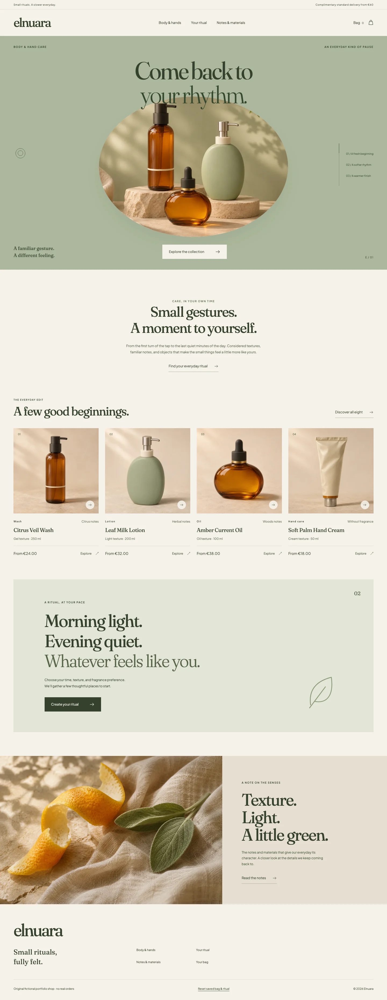
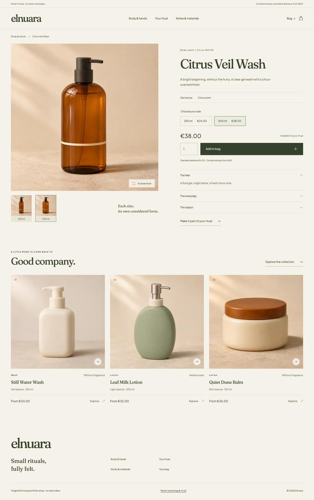
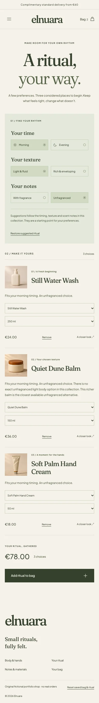

# Elnuara

Small rituals, fully felt.

An original fictional body-care shop and ritual builder, created in **November 2026** as a frontend engineering portfolio application. A sculptural sage product stage leads into eight considered body and hand-care essentials, sixteen size-specific variants, and a complete local demonstration checkout.



**[Verified live demo](https://khalilbenali1.github.io/elnuara-body-sveltekit/)** · **[Source](https://github.com/khalilBenAli1/elnuara-body-sveltekit)** · [Public release evidence](docs/PUBLIC_VERIFICATION.json)

## An everyday ritual, your way

- Explore by product type, scent and starting price, with composed, shareable URL filters and a deliberate empty state.
- Visit eight prerendered product routes. Each size has its own photograph, price, stock limit and selected state. Native keyboard-accessible controls and an enlarged gallery preserve focus.
- Keep different sizes separate in the persistent bag; repeated additions of the same size merge. All prices and delivery calculations use integer EUR cents.
- Shape a ritual around morning/evening, light/rich texture and fragrance preferences. Explanations describe actual fixture matches and alternatives: an unfragranced light body option does not exist, so the richer alternative is stated honestly.
- Edit sizes and products, remove any choices, and add **any nonempty valid reduced ritual**. Addition is atomic against existing bag quantities; an unavailable or overstocked choice leaves the entire bag unchanged.
- Complete details → review → detached local confirmation. No card fields, payment, order transmission or email sending. Details stay in feature memory, and the copied confirmation survives bag/reset changes during the visit.
- Recover safely from malformed, unknown-version or blocked browser storage. Reset touches only Elnuara’s namespaced key and leaves other demos’ data intact.

Standard delivery is **€4.50**, complimentary at **€60**. These are fictional demo amounts; there are no live inventory, pricing or shipping services.



## Run locally

Use **Node 22.23.1** and **npm 10.9.8**. Exact package versions and one lockfile are committed. Project-local `.npmrc` sets `legacy-peer-deps=false`, so a contributor’s global npm preferences cannot change the CI installation contract.

```sh
nvm use
npm ci
npm run dev
```

Open [http://127.0.0.1:4206/elnuara-body-sveltekit/](http://127.0.0.1:4206/elnuara-body-sveltekit/). The project base is intentional locally and on GitHub Pages. For the production export:

```sh
npm run build
npm run preview
```

Restart a retained preview after rebuilding; its in-memory manifest must match the exported files.

```sh
npm run lint
npm run format:check
npm run typecheck
npm test
npx playwright install chromium webkit
npm run test:e2e
```

`npm run check` runs lint, formatting, strict types, unit tests and the static build. The browser suite uses both Chromium and WebKit, default per-test timeouts and **zero retries**. A `DEMO_URL` override can point the same local-demo journeys at a verified deployment. They never create real orders.

## Engineering and evidence

Svelte **5.57.3**, SvelteKit **3.1.1**, supported adapter-static **4.0.1**, Vite **8.3.5** and TypeScript **6.0.3**. Native CSS, exclusive self-hosted **Fraunces + Plus Jakarta Sans** typography, Svelte rune-based per-layout state, and no extra state framework or runtime backend.

Pages compose focused catalog, product, bag, ritual and checkout features. Pure domain rules, fixture data, URL parsing, storage and shared state have separate boundaries. SvelteKit 3’s supported shallow navigation reads its active shallow URL; cold-query reads happen after mount to prevent hydration mismatches. Late native close events cannot dismiss an already reopened modal.

The final local gate passed **46 unit tests and 88 browser cases** across both engines. Tests cover actual journeys, canonical per-size contracts, atomic transitions, supported unquoted email boundaries, maximum-length details, contacts privacy, SSR instance isolation, cold query hydration, storage recovery, touch, keyboard, modal lifetime, reduced motion, Axe and `clientWidth`-based reflow. Critical text, including prices, is doubled exactly and idempotently at 390/768/1440, with additional 320px reflow and doubled-text cases. Automated scans do not constitute accessibility certification.

- [Architecture and data ownership](docs/ARCHITECTURE.md)
- [Quality, payload and verification evidence](docs/DELIVERY.md)
- [Actual measured production output](docs/BUILD_MEASUREMENTS.json)
- [Actual screenshot and bag-price measurements](docs/BROWSER_CAPTURES.json)
- [Design research and original direction](docs/DESIGN.md)
- [Asset and font licensing](ASSETS.md)
- [Exact original image provenance and prompts](docs/IMAGE_PROVENANCE.md)



## Demo and reset

Use invented details in checkout. Preferences, bag identifiers and quantities are stored locally under `elnuara.body.state.v1`; contacts and confirmations are never persisted or transmitted by the application. Choose **Reset saved bag & ritual** in the footer to clear that key. Unreadable data is preserved until an explicit reset. With blocked storage the open session remains usable, but cannot promise persistence across reloads.

The catalog and sensory notes are fictional. There are no medical benefits, clinical results, certifications, reviews, endorsements or skin predictions. Starting-price filters include a product when at least one size fits the cap; larger sizes can have different prices. Stock is a fixed demonstration limit, with no reservation or server enforcement. There is no cross-device or cross-tab synchronization, offline installation, customer account, payment processor or real commerce. A confirmation is memory-only and ends when its feature is left or the page reloads. Country and postal validation is demonstration formatting, not address verification.

Current development-tool audit findings and real-device accessibility limits are disclosed in the delivery notes. No invented Lighthouse score is claimed.

Original code: [MIT](LICENSE). Fonts retain their included [OFL notices](docs/licenses). Image provenance does not claim exclusive legal rights in generated artwork.
