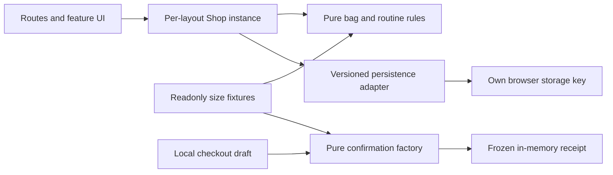

# Elnuara architecture

Elnuara is a static SvelteKit storefront for an original fictional body-care brand. Eight local products have sixteen distinct size variants. Each size owns its price, stock and matching image; the routine builder explains product preferences using these fixtures.

## Boundaries

| Boundary                          | Responsibility                                                                                                                                           |
| --------------------------------- | -------------------------------------------------------------------------------------------------------------------------------------------------------- |
| `src/routes/`                     | Compose the homepage, collection, product, ritual, materials and checkout experiences.                                                                   |
| `src/lib/features/`               | Focused collection, product selection, bag, routine and checkout presentation.                                                                           |
| `src/lib/data/catalog.ts`         | Readonly canonical product and size fixtures, descriptive stories and material notes.                                                                    |
| `src/lib/domain/`                 | Framework-independent identifiers, filters, stock transitions, integer-cent pricing, routine explanations, contact validation and confirmation creation. |
| `src/lib/state/shop.svelte.ts`    | A per-layout Svelte reactive shop instance connecting shared bag, routine and preference choices.                                                        |
| `src/lib/adapters/persistence.ts` | Strict parsing and storage operations through an injected browser storage port.                                                                          |
| `static/images/`                  | Original optimized product-size photographs and campaign artwork.                                                                                        |

Domain functions import neither Svelte, browser APIs nor storage. Pages and feature markup do not own delivery rules, stock admission or contact validation. Shared state holds source choices; totals and resolved product information are derived.

## State ownership and hydration

The layout creates a `Shop` instance with `createShop()` and provides it through Svelte context. Each instance has its own `$state` source records and storage port. The module-level context symbol is an immutable key, not a shared customer store. A new layout instance receives fresh bag, routine and preference data, including during server rendering.

Bag lines, routine choices and preferences are genuinely shared across routes. Counts and totals are getters derived from those choices. Menus, gallery state, form fields and checkout steps remain in their feature components. The checkout keeps its frozen confirmation in an immutable-compatible `$state.raw` holder; neither the contact draft nor receipt enters `Shop` or its persisted schema.

Browser storage hydrates only after mount. The first server and client render therefore share deterministic fixture defaults. Collection filters use a local draft and serialized navigation updates, so rapid changes compose before URL replacement. Supported query choices are read after mount rather than changing the static hydration tree prematurely.

## Cart and pricing rules

Bag identity is the pair `{productId, variantId}`. Adding the same size merges quantities; another size remains a separate line. Stock limits apply to the aggregate quantity for that exact variant. A proposed routine addition is prepared as a new bag and accepted only when all remaining choices fit available stock; failure leaves the previous bag intact.

All prices are integer cents from the selected size fixture. `totals()` calculates subtotal, piece count and standard delivery: 450 cents below 6000 cents, with delivery included at or above that threshold. The bag and confirmation reuse this calculation. Display formatting is separate from arithmetic.

## Routine preferences

The ritual has cleanse, body and hands slots. Preferences describe morning/evening use, light/rich texture and fragranced/unfragranced products. Suggestions and explanations use explicit fixture scent, texture and daypart fields, without inferring skin condition or medical suitability.

There is no exact unfragranced light body fixture. Its suggested richer alternative is described honestly. That balm-specific explanation applies only when the actual selected product is unfragranced and rich. A manual edit to a woods-scented oil receives its real scent and texture mismatch explanation instead. Manual changes never inherit a description that belongs to another product.

Users can change sizes or remove individual slots. The subtotal follows the remaining selections, and any nonempty valid reduced ritual can be added. Empty, invalid, unavailable or over-stock additions fail as one operation. Recommendations are demonstrations of product preferences, not treatment advice.

## Validated persistence

The adapter owns `elnuara.body.state.v1`. Its versioned envelope contains only bag lines, routine choices and the three preference fields. It checks exact record fields, finite known identifiers, available variants, quantity bounds and valid slot/preferences before admission. Payloads above 16,000 encoded bytes are rejected.

Blocked access, malformed JSON, unsupported versions or invalid records recover to a fresh usable session. An existing corrupt payload is left untouched; automatic writes are suspended until the user explicitly resets it. Reset removes this application's key alone. Other apps on the shared GitHub Pages origin retain their own state. Save operations also validate the proposed envelope, so contact or payment fields cannot silently join it.

## Local checkout and receipt

The draft contains name, email, address, city, postal code and destination. Validation supports international names and a bounded unquoted email format, including plus, dot and apostrophe. Address and postal checks are basic local format checks; no mailbox, DNS or delivery-address verification is claimed.

`createConfirmation()` validates the whole nonempty bag and contact draft before creating a receipt. It copies known contact fields and flattened product name, selected size, matching image, unit cents and quantity. New contact, line, array, totals and receipt objects are frozen. Later bag resets or mutations of the original draft cannot change the confirmed details or amount. These contact details exist only in feature memory; there is no persisted order, payment or message operation.

## Static delivery and evidence

The supported static adapter produces files for the repository base `/elnuara-body-sveltekit`. Product routes are generated from finite fixtures, so direct links do not require a runtime commerce service. Images and licensed Fraunces/Plus Jakarta Sans fonts are self-hosted. Product images belong to their exact sizes, and campaign objects reference those canonical packages.

The README and delivery evidence record the final verification commands, actual captures, measured payloads and limits. Domain/store tests protect transitions and isolation; browser journeys check the rendered experience, including hydration, touch, keyboard focus, reduced motion and narrow/increased text. No performance or accessibility certification is implied by these checks.

SvelteKit3 shallow navigation exposes its current address through `page.shallow.url`; the collection synchronizes from that URL (falling back to `page.url` for a cold/full route). Reading only `page.url` after shallow navigation would otherwise restore the old filter state.
